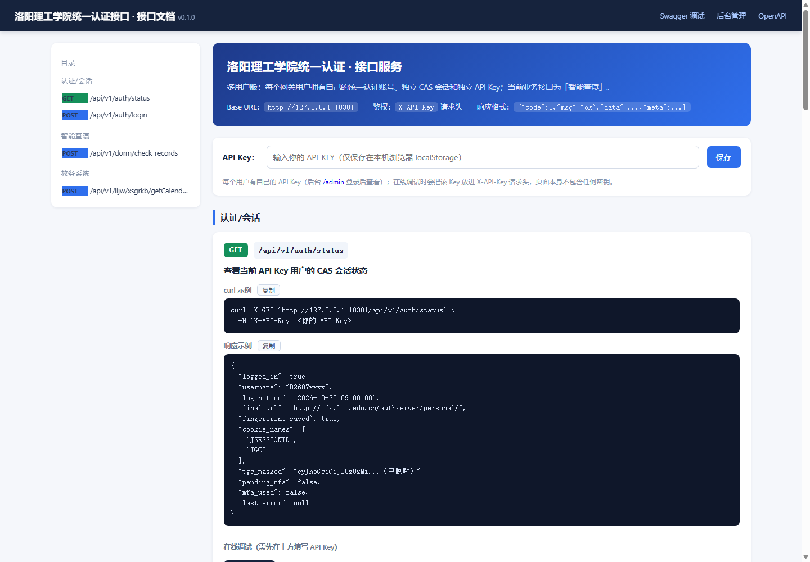
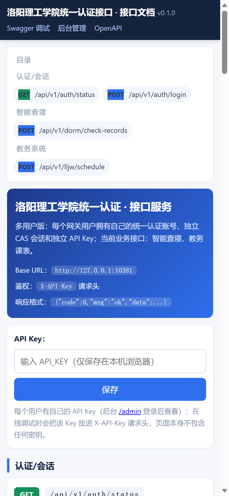
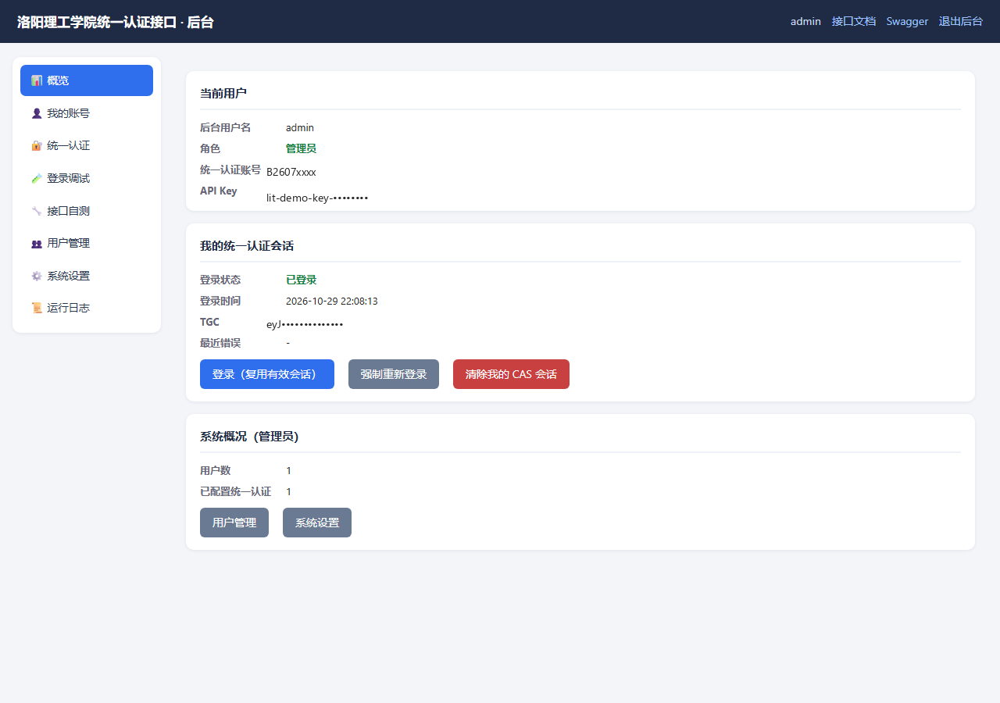
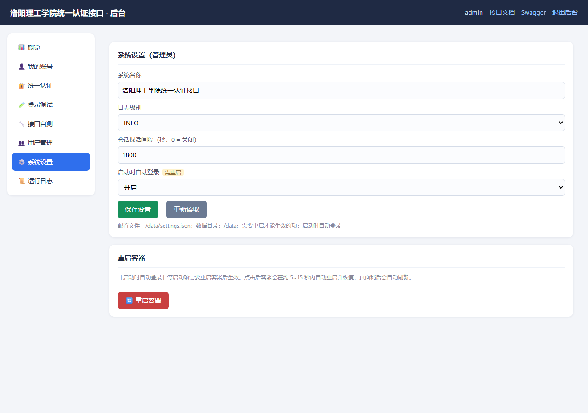
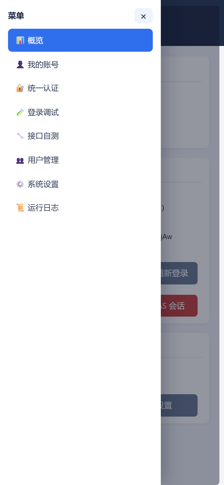

# 洛阳理工学院统一认证 · 多用户接口服务（LIT API Gateway）

以 **CAS 统一认证脚本（`lit_login.py`）为核心**、**Docker** 容器化部署的校园系统接口网关，**多用户 + 菜单式后台 + 配置后台化**：

* 👥 **多用户**：后台支持多个用户登录，**每个用户配置自己的统一认证账号并使用自己的 API Key 调用接口**；
* 🖥️ **菜单式后台**（`/admin`）：左侧菜单切换「概览 / 我的账号 / 统一认证 / 登录调试 / 接口自测 / 用户管理 / 系统设置 / 运行日志」；
* ⚙️ **配置后台化**：`.env` 只保留初始化信息，**能在后台改的配置全部放到了「系统设置」**（系统名称、日志级别、会话保活、启动自动登录）；
* 🔄 **一键重启容器**：需要重启才生效的配置（如「启动时自动登录」）在后台直接点「重启容器」，容器自动重启恢复；
* 🔐 **统一认证核心**：账号密码 + 自动识别滑块验证码 + 企业微信二次验证 + 每个用户独立的 CAS 会话（TGC）持久化；
* 🔑 **每人一个 API Key**：请求头 `X-API-Key` 决定使用哪个用户的统一认证会话；重新生成后旧 Key 立即失效；
* 📖 **前台接口文档**（`/`）：参数说明、curl 示例、请求/响应示例、在线调试，由 OpenAPI 自动生成；
* 🎓 **业务系统**：智能查寝（xsfw WIS 平台 `zncqapp`），通过 CAS SSO 免密进入；
* ✅ **业务接口**：`POST /api/v1/dorm/check-records`（智能查寝，**自有参数/易读返回**，内部调用官方 `cqztbg.do`）。

> 运行参数（系统名称/日志级别/会话保活/启动自动登录）**只在后台「系统设置」修改**（`data/settings.json`），`.env` 仅用于部署与首次引导。
> （`LIT_*`、`SESSION_REFRESH_INTERVAL` 等已移除）。旧 .env 请只保留下面的初始化配置。

---

## 1. 架构

```
                       ┌──────────────────── Docker: lit-api ─────────────────────────┐
                       │  FastAPI                                                     │
  HTTP / X-API-Key ──► │   ├─ deps: X-API-Key → 用户 → 该用户的 CAS 会话/系统实例        │
  /admin cookie ─────► │   ├─ routers/                                                 │
                       │   │    ├─ docs.py      前台接口文档（/）                       │
                       │   │    ├─ admin.py     菜单式后台（登录/用户管理/系统设置/重启）  │
                       │   │    ├─ auth.py      /api/v1/auth/*（按 API Key 用户）        │
                       │   │    └─ dorm.py      智能查寝接口（自有参数/易读返回）        │
                       │   ├─ users.py          用户存储（密码哈希/API Key/每人 CAS 账号）│
                       │   ├─ registry.py       每个用户一个 SessionManager + XsfwSystem │
                       │   ├─ session.py        单用户 CAS 会话（登录/复用/MFA/持久化）  │
                       │   ├─ settings_store.py 后台「系统设置」（data/settings.json）   │
                       │   ├─ restart.py        后台「重启容器」                        │
                       │   └─ systems/xsfw.py   智能查寝适配（SSO + 角色 + check-records）│
                       │                                                              │
                       │  lit_login.py（统一认证核心：AES / 滑块验证码 / MFA / TGC）     │
                       └──────────────┬──────────────────────────┬────────────────────┘
                                      │ data/users.json           │ HTTPS
                                      │ data/sessions/<uid>.json  ▼
                                      │ data/settings.json   CAS ids.lit.edu.cn
                                      ▼                      xsfw.sec.lit.edu.cn
                                用户/账号/API Key/系统设置
```

请求链路：`X-API-Key → 网关用户 → 该用户自己的 CAS 会话（必要时自动登录） → xsfw SSO + 角色 → 智能查寝 check-records`。
后台链路：`用户名+密码 → 签名 cookie → 菜单式管理自己的账号/会话/API Key；管理员额外管理用户与系统设置`。

## 2. 快速开始（Docker Compose）

```bash
# 1) 只需要初始化配置（其余都在后台）
cp .env.example .env
#    ADMIN_USERNAME / ADMIN_PASSWORD：第一个管理员（用户表为空时创建）
#    API_KEY：管理员初始 API Key（不填会自动生成，可在后台查看）

# 2) 构建并启动
docker compose up -d --build

# 3) 打开后台
#    http://127.0.0.1:10381/admin   （默认 admin / .env 里的 ADMIN_PASSWORD）
#    若 .env 未设置 ADMIN_PASSWORD：首次启动会随机生成，见 data/admin-password.txt
```

后台菜单使用顺序：

1. **🔐 统一认证**：配置自己的统一认证账号、密码、设备指纹；
2. **🧪 登录调试**：点「登录」；新设备需要企业微信验证码时，在这里输入并提交；
3. **👤 我的账号**：查看/复制/重新生成自己的 **API Key**；
4. **👥 用户管理**（管理员）：创建其他用户 → 把各自的 API Key 交给对方；普通用户看不到该菜单；
5. **⚙️ 系统设置**（管理员）：系统名称、日志级别、会话保活间隔、启动自动登录；
   需要重启的项（带「需重启」标记）改完点 **🔄 重启容器**；
6. **🔧 接口自测 / 📜 运行日志**：用自己的会话验证接口、查看日志。

```bash
# 调用接口（每个用户用自己的 Key）
curl -X POST -H "X-API-Key: <你的 API Key>" -H "Content-Type: application/json" \
     -d '{"classCode":"B260714","checkStatus":"not_returned"}' \
     "http://127.0.0.1:10381/api/v1/dorm/check-records"
```

入口一览：

* **后台（菜单式，多用户）**：<http://127.0.0.1:10381/admin>
* **前台接口文档**：<http://127.0.0.1:10381/>
* **Swagger**：<http://127.0.0.1:10381/docs>
* 健康检查：`/healthz`、`/readyz`

> 默认只监听宿主机 `127.0.0.1:10381`；需要局域网访问时设置 `API_BIND=0.0.0.0 API_PORT=10381` 后重新 `docker compose up -d`。
> 国内网络构建慢可加 `--build-arg PIP_INDEX_URL=https://pypi.tuna.tsinghua.edu.cn/simple`
> （或设置同名环境变量；`docker compose build` 会读取）。

### 2.1 镜像与 Compose 规范（本仓库已满足）

| 规范 | 本仓库做法 |
| --- | --- |
| 基础镜像 | `python:3.12-slim-bookworm`（Debian 版本明确；生产建议进一步固定 `@sha256` 摘要）；镜像内 `DATA_DIR=/data`，可独立 `docker run`（不挂卷时自动使用匿名卷） |
| 非 root | 创建 `appuser`，`USER appuser` 运行；`/app` 属主直接设为运行用户 |
| 依赖可复现 | `requirements.txt` 固定精确版本（`==`），利用 Docker 层缓存 |
| 最小上下文 | `.dockerignore` 排除 `data/ docs/ tests/ .env* README` 等，镜像内只有 `app/`、`lit_login.py`、`requirements.txt` |
| 健康检查 | 镜像内置 `HEALTHCHECK` 访问 `/healthz`（compose 继承，`docker ps` 显示 healthy） |
| 启动/信号 | exec 形式 `CMD ["uvicorn", ...]`、`STOPSIGNAL SIGTERM`、`EXPOSE 10381` |
| 元数据 | OCI `LABEL`（title/description/version/licenses） |
| 持久化 | `VOLUME ["/data"]` + compose bind mount `./data:/data`（用户/会话/设置都在这里） |
| 运行加固 | `read_only` 根文件系统 + `/tmp` tmpfs、`cap_drop: ALL`、`no-new-privileges`、`init: true`、`pids_limit`、日志轮转、`restart: unless-stopped`、`stop_grace_period` |
| 端口暴露 | 默认仅绑定 `127.0.0.1`（可通过 `API_BIND` 改） |

### 2.2 fnOS（飞牛OS）部署

fnOS 上不需要源码、不需要构建，直接用 [docker-compose.fnos.yml](docker-compose.fnos.yml) 拉取镜像运行：

1. fnOS「应用中心 → Docker → Compose → 新建项目」，粘贴 `docker-compose.fnos.yml`；
2. **提前创建数据目录并归 NAS 用户所有**（默认 UID/GID 1000，即 fnOS 默认用户）：

   ```bash
   mkdir -p data
   ```

3. 项目 `.env`（可选，与 compose 同目录）：

   ```env
   # ADMIN_PASSWORD=            # 不填则首次启动随机生成，保存到 data/admin-password.txt
   # API_KEY=                   # 留空则自动生成，可在后台「我的账号」查看
   # DATA_PATH=./data           # 或绝对路径，如 /vol1/1000/docker/lit-api/data
   # PUID=1000
   # PGID=1000
   # API_PORT=10381
   # API_BIND=0.0.0.0
   ```

4. 启动后访问 `http://<NAS-IP>:10381/admin`，用 `admin` + 初始密码登录，再去「统一认证」配置自己的账号。
   初始密码：设置了 `ADMIN_PASSWORD` 就用它；**没设置则首次启动随机生成**，查看方式：

   ```bash
   cat data/admin-password.txt
   # 或
   docker exec lit-api-gateway cat /data/admin-password.txt
   ```

   登录后建议到「👤 我的账号 → 修改后台密码」改成自己的密码，并删除 `admin-password.txt`。

镜像由 GitHub Actions 自动构建（`linux/amd64` + `linux/arm64`）并推送到
`ghcr.io/shihao618/lit-api-gateway:latest`；首次使用需到 GitHub → Packages 把该镜像包设为 **Public**
（或在 NAS 上 `docker login ghcr.io` 后使用私有镜像）。

* 数据都在 `data/`：`users.json`、`sessions/`、`settings.json`、`.gateway_secret`，
  以及未设置 `ADMIN_PASSWORD` 时生成的 `admin-password.txt`；
  备份/迁移直接打包该目录（`.gateway_secret` 必须一起迁移，否则后台登录态失效）。
* 更新镜像：
  ```bash
  docker compose -f docker-compose.fnos.yml pull
  docker compose -f docker-compose.fnos.yml up -d
  ```

## 3. 配置

### 3.1 `.env`（仅初始化 / 部署基础设施）

| 变量 | 默认值 | 说明 |
| --- | --- | --- |
| `ADMIN_USERNAME` | `admin` | **仅首次引导**：第一个管理员后台登录名 |
| `ADMIN_PASSWORD` | 空 | **仅首次引导**：管理员后台初始密码；**不填则随机生成并保存到 `<DATA_DIR>/admin-password.txt`**（权限 600） |
| `API_KEY` | 空 | **仅首次引导**：管理员初始 API Key（不填自动生成，可在后台查看/重置） |
| `DATA_DIR` | `data` | 数据目录（容器内固定 `/data`） |
| `ADMIN_SECRET` | 空 | 可选：后台 cookie 签名密钥（不填自动生成到 `<DATA_DIR>/.gateway_secret`） |
| `USERS_FILE` / `SESSION_DIR` / `SETTINGS_FILE` | 由 `DATA_DIR` 派生 | 一般不需要设置 |

### 3.2 后台「系统设置」（保存在 `data/settings.json`，无需改 .env）

| 配置 | 说明 | 生效方式 |
| --- | --- | --- |
| 系统名称 `app_name` | 后台/前台文档页面标题（Swagger 页标题需重启） | 保存后即时 |
| 日志级别 `log_level` | DEBUG / INFO / WARNING / ERROR | 保存后即时 |
| 会话保活间隔 `session_refresh_interval` | 秒；0 = 关闭定时保活 | 保存后即时（后台任务按新间隔执行） |
| 启动时自动登录 `auto_login_on_start` | 是否为已配置统一认证账号的用户在启动时自动登录 | **需重启容器**（后台点「🔄 重启容器」） |

> 数据目录里还会看到：`users.json`（用户/账号/API Key）、`sessions/<user-id>.json`（各用户 CAS 会话）、
> `settings.json`（系统设置）、`.gateway_secret`（后台 cookie 签名密钥），以及随机生成的
> `admin-password.txt`（未配置 `ADMIN_PASSWORD` 时，登录后建议修改密码并删除该文件）。

## 4. API 文档

**所有 `/api/v1/**` 接口都需要请求头 `X-API-Key`**；每个用户的 Key 对应其自己的统一认证会话。

| 方法 | 路径 | 说明 |
| --- | --- | --- |
| GET | `/` | 前台接口文档页面（自动生成，含在线调试） |
| GET | `/healthz` / `/readyz` | 健康检查（无需鉴权） |
| GET | `/api/v1/auth/status` | 当前 API Key 用户的 CAS 会话状态 |
| POST | `/api/v1/auth/login` | 登录/刷新当前 API Key 用户的统一认证会话（可带 `mfa_code`） |
| **POST** | **`/api/v1/dorm/check-records`** | **智能查寝-查寝记录（自有参数/易读返回）** |
| **POST** | **`/api/v1/lljw/schedule`** | **教务系统-课表查询（自有参数/易读返回，学期/周次可自动）** |

### 4.1 智能查寝-查寝记录（自有接口 / 易读返回）

`POST /api/v1/dorm/check-records`（JSON 请求体，只保留 3 个参数）

| 参数 | 类型 | 必填 | 说明 |
| --- | --- | --- | --- |
| `classCode` | string | 否 | 班级代码，如 `B260714`；不传=当前账号可见范围 |
| `checkStatus` | string | 否 | `not_returned` 未归寝 / `returned` 已归寝 / `leave` 离校请假（也接受中文） |
| `checkStatusType` | string | 否 | `unreachable` 未联系上 / `reported` 已报备 / `normal` 正常归寝 / `late` 晚归（也接受中文） |

**查寝状态**

| 新参数值 | 中文 |
| --- | --- |
| `not_returned` | 未归寝 |
| `returned` | 已归寝 |
| `leave` | 离校请假 |

**查寝状态类型**

| 新参数值 | 中文 |
| --- | --- |
| `unreachable` | 未联系上 |
| `reported` | 已报备 |
| `normal` | 正常归寝 |
| `late` | 晚归 |

```bash
curl -X POST "http://127.0.0.1:10381/api/v1/dorm/check-records" \
  -H "X-API-Key: <你的 Key>" -H "Content-Type: application/json" \
  -d '{"classCode":"B260714","checkStatus":"not_returned","checkStatusType":"unreachable"}'
```

返回易读结构（自动翻页拉全，无需传分页参数）：

```json
{"code":0,"msg":"ok","data":{"total":1,"items":[{
  "studentId":"B2607xxxx","name":"示例同学","classCode":"B260714",
  "className":"智科(专升本)B260714","collegeName":"人工智能学院/未来技术学院",
  "majorName":"智能科学与技术","dormBuilding":"xx学生公寓","roomNumber":"218",
  "bedNumber":"2","phone":"138****0000",
  "checkStatus":"returned","checkStatusLabel":"已归寝",
  "checkStatusType":"normal","checkStatusTypeLabel":"正常归寝"}]}}
```

> 不再暴露官方原始字段（`WID/GZXS/CQZT/CQZTLX/querySetting/...`）；内部由网关拼 `querySetting` 调用官方 `cqztbg.do`，并按 200 条/页自动拉全。

### 4.2 教务系统-课表查询（自有接口 / 易读返回）

`POST /api/v1/lljw/schedule`（JSON 请求体）

| 参数 | 类型 | 必填 | 默认 | 说明 |
| --- | --- | --- | --- | --- |
| `semester` | string | 否 | 自动当前学期 | 学期代码（如 `202601`），也接受名称 `2026-2027-1` |
| `week` | int / `"all"` / `0` | 否 | 自动本周 | `1~N`；`"all"`/`0` = 全部周；仅 `query=week` 使用 |
| `query` | string | 否 | `week` | `week` / `today` / `morning` / `afternoon` / `evening` / `day` / `next` |
| `date` | string | 否 | - | `query=day` 时必填，格式 `YYYY-MM-DD` |

**查询类型**

| query | 返回 |
| --- | --- |
| `week` | 指定周/当前周全部课程 |
| `today` | 今天全部课程（含上午/下午/晚上） |
| `morning` | 今天上午：`pe <= 4`（第 1~4 节） |
| `afternoon` | 今天下午：`5 <= ps <= 8`（第 5~8 节） |
| `evening` | 今天晚上：`ps >= 9`（第 9~10 节，19:10 后） |
| `day` | 指定日期（`date`）当天的课程 |
| `next` | 从当前时间起最近一节课；本周没有则往后周找 |

**自动取值**

- `semester` 省略：解析教务 `week.page` 下拉框的选中项；
- `week` 省略（`query=week`）：第 1 周周一日期 + 当前日期推算（当前 2026-10-31 = 第 8 周）；
- 当天不在学期内（寒暑假）→ 返回 `422`，提示手动传 `week`；
- 时区统一按北京时间（UTC+8）。

```bash
# 当前学期 + 当前周
curl -X POST "http://127.0.0.1:10381/api/v1/lljw/schedule" \
  -H "X-API-Key: <你的 Key>" -H "Content-Type: application/json" \
  -d '{}'

# 指定第 7 周
-d '{"week":7}'

# 全部周
-d '{"week":"all"}'

# 今天 / 上午 / 下午 / 晚上 / 最近一节
-d '{"query":"today"}'
-d '{"query":"morning"}'
-d '{"query":"afternoon"}'
-d '{"query":"evening"}'
-d '{"query":"next"}'

# 指定日期
-d '{"query":"day","date":"2026-10-29"}'
```

返回（易读字段，带节次/时间/周日期）：

```json
{"code":0,"msg":"ok","data":{
  "semester":"202601","semesterName":"2026-2027-1",
  "query":"day","week":8,
  "weekStart":"2026-10-26","weekEnd":"2026-11-01",
  "date":"2026-10-29","total":2,
  "items":[{
    "courseName":"复变函数与积分变换III","courseCode":"10005536",
    "teacher":"示例教师","location":"XC3","className":"示例班级",
    "date":"2026-10-29","weekday":"周四","week":8,
    "startPeriod":"01","endPeriod":"02","periodLabel":"第1-2节",
    "startTime":"08:00","endTime":"09:40","weeks":"8","color":"#009688"
  }]}}
```

> 旧 `getCalendarWeekDatas` 路由已删除；网关内部自动调用官方课表接口并按 `ps/pe` 节次归类、按日期过滤。

### 4.3 多用户与 API Key 规则

* 后台「👤 我的账号」可查看/复制/重新生成自己的 Key；**重新生成后旧 Key 立即失效**；
* 不同 Key 对应不同用户的统一认证会话，互不影响；
* 用户未配置统一认证账号时，业务接口返回 `503 SESSION_ERROR`（提示先到后台配置）；
* 管理员可在「👥 用户管理」为用户重置密码/重置 Key/设置统一认证账号/删除用户。

## 5. 前台接口文档页面（`/`）

浏览器打开 **http://127.0.0.1:10381/**，无需登录后台。



移动端（390px 视口）已适配：



* 由 FastAPI 的 OpenAPI 自动生成，新增接口后刷新页面自动出现；
* 左侧按模块分组导航；每个接口包含参数表、curl 示例、响应示例；
* **在线调试**：页面顶部填写自己的 API Key（只存 localStorage），修改参数后点「发送请求」；
* 页面不包含任何密钥；标题取自后台「系统设置」里的系统名称。

## 6. 后台调试界面（`/admin`，菜单模式）

用 `ADMIN_USERNAME / ADMIN_PASSWORD`（或管理员创建的用户）登录。





移动端（390px 视口）已适配：菜单为汉堡抽屉式，表单全宽，用户表格横向滚动：



| 菜单 | 功能 |
| --- | --- |
| 📊 概览 | 当前用户、自己的统一认证会话状态、快捷登录/清除会话；管理员可看用户概况 |
| 👤 我的账号 | 查看/复制/重新生成自己的 API Key；修改后台密码 |
| 🔐 统一认证 | 配置自己的统一认证账号、密码、设备指纹；清除自己的 CAS 会话 |
| 🧪 登录调试 | 登录/强制重新登录；展示滑块验证码识别过程；输入企业微信验证码/重新发送 |
| 🔧 接口自测 | 用自己的会话测试角色、菜单、学生归寝（官方参数）、状态字典、通用调用 |
| 👥 用户管理 | 管理员：创建/删除用户，重置密码/API Key，设置用户的统一认证账号 |
| ⚙️ 系统设置 | 管理员：系统名称、日志级别、会话保活间隔、启动自动登录；**重启容器**按钮 |
| 📜 运行日志 | 最近日志滚动查看（登录、SSO、接口调用） |

### 6.1 重启容器怎么实现

后台「系统设置 → 重启容器」会让容器内进程优雅退出（SIGTERM），
`docker-compose.yml` 的 `restart: unless-stopped` 策略随即把容器重新拉起，
效果等同于重启容器（无需挂载 Docker socket）。页面会显示「容器重启中…」并轮询 `/healthz`，恢复后自动刷新。

> 本地直接 `uvicorn` 运行时点这个按钮会终止进程（不会自动拉起），属预期行为。

## 7. 会话机制

```
每个用户独立：
  启动（若 auto_login_on_start） / 首次调用  ──► CAS 登录（自动识别滑块验证码；指纹受信任则免 MFA）──► 该用户 TGC 落盘
  每次接口调用 ──► TGC 有效？ 复用 : 自动重新登录 ──► CAS SSO 到 xsfw ──► setAppRole ──► 业务接口
```

* 判断 CAS 会话是否有效不能用 `/authserver/personal/`（SPA 外壳未登录也 200），
  应看 `GET /authserver/login` 是否 302 到 `/authserver/personal/`；
* `auto_login_on_start`、`session_refresh_interval` 都在后台「系统设置」里改；
* 指纹受信任（约 30 天）时自动登录不需要企业微信验证码；否则在「登录调试」输入验证码。

## 8. 目录结构

```
lit_login.py            统一认证核心（AES / 滑块验证码 / MFA / 会话校验）
app/
  main.py               FastAPI 入口（生命周期、多用户引导、后台任务、异常处理）
  config.py             部署级配置（仅 .env 初始化项）
  settings_store.py     后台「系统设置」存储 + 日志级别热更新
  restart.py            后台「重启容器」（SIGTERM + restart 策略）
  users.py              多用户存储（密码哈希 / API Key / 每人统一认证账号）
  registry.py           每个用户一个 SessionManager + XsfwSystem/LljwSystem
  session.py            单用户 CAS 会话（登录/复用/MFA/持久化）
  admin_auth.py         后台登录鉴权（用户名密码 + HMAC 签名 cookie）
  deps.py               X-API-Key → 用户 → 该用户会话/系统
  logbuf.py             内存日志缓冲（后台「运行日志」）
  schemas.py            请求/响应模型
  systems/
    base.py             BaseSystem 抽象
    xsfw.py             智能查寝适配（SSO + 角色 + check-records→cqztbg.do）
    lljw.py             教务系统适配（SSO + 学期/周次自动 + schedule）
  routers/
    docs.py             前台接口文档（自动生成）
    admin.py            菜单式后台 + 后台 API
    dorm.py             智能查寝接口路由（自有参数/易读返回）
    lljw.py             教务系统接口路由
    auth.py             会话状态/登录（按 API Key 用户）
    health.py           健康检查
tests/                  离线测试（39 个）：认证核心 / 两个业务接口 / 多用户后台 / 系统设置
Dockerfile              python:3.12-slim-bookworm、非 root、健康检查
docker-compose.yml      本地/服务器部署（源码构建）：数据卷 ./data:/data、env_file .env、端口 10381
docker-compose.fnos.yml fnOS（飞牛OS）部署：直接用 GHCR 镜像，无需源码/构建
.github/workflows/docker-publish.yml  GitHub Actions：构建并推送多架构镜像到 GHCR
.env.example            初始化配置模板
docs/                   界面截图
data/                   用户表、各用户 CAS 会话、系统设置（运行时生成，勿提交）
```

## 9. 本地开发与测试

```bash
pip install -r requirements-dev.txt
python -m pytest tests -q          # 39 passed（离线，不访问校园网）
uvicorn app.main:app --host 0.0.0.0 --port 10381 --reload
```

测试覆盖：CAS 核心工具、API Key 鉴权、智能查寝 check-records、教务 schedule 参数/节次/映射、多用户登录/创建/删除、
密码/Key 重置、权限隔离、系统设置读取/保存/重启按钮（mock）、MFA 联动。

## 10. 扩展新系统 / 新接口

**新增智能查寝接口**：在 `app/systems/xsfw.py` 加语义化方法，在 `app/routers/dorm.py` 加路由（自有参数/易读返回）。

**新增业务系统**（如教务系统）：在 `app/systems/` 新建适配器（继承 `BaseSystem`）→
在 `app/registry.py` 注册该系统实例（按用户）→ 在 `deps.py` 加依赖 → 在 `routers/` 加路由并挂到 `main.py`。

## 11. 命令行工具（单账号调试用）

```bash
# 单账号登录调试（生成 cookies.json）；账号密码用参数或环境变量提供，代码里没有默认凭据
python lit_login.py -u B2607xxxx -p 'your-password'
python lit_login.py -u B2607xxxx -p 'your-password' --force-login
# 或：LIT_USERNAME=... LIT_PASSWORD=... python lit_login.py
```

> 该脚本是单账号调试工具，与网关的多用户数据（`data/users.json`、`data/sessions/`）相互独立；
> 统一认证账号不写在代码里（否则会泄露到镜像/仓库）。

## 12. 已知问题 / FAQ

| 现象 | 说明 / 处理 |
| --- | --- |
| 改了「启动时自动登录」没生效 | 该项带「需重启」标记，去「系统设置」页点「🔄 重启容器」 |
| 重启容器后页面打不开 | 等待 5~15 秒后刷新；若仍失败查看 `docker compose logs -f` |
| 忘记后台密码 | 让其他管理员在「用户管理」重置；只有一个管理员时删除 `data/users.json` 会清空所有用户（可用 .env 重新引导） |
| 新用户调用接口返回 503 SESSION_ERROR | 该用户还没配置统一认证账号，或密码错误/需要企业微信验证码 |
| 需要重新生成 API Key | 后台「👤 我的账号」点重新生成；旧 Key 立即失效 |
| 查寝记录无数据 | 所选条件确实没有匹配学生：返回 `data.total` 为 0 / `items` 为空 |
| 多个用户能否用同一个统一认证账号 | 可以，但每个用户各自建立/维护自己的 CAS 会话（各自独立登录、各自 API Key） |
| 统一认证已掉线但后台显示「已登录」 | 已修复：后台概览/`/api/v1/auth/status` 会用 TGC 实测会话有效性（30 秒缓存），失效显示「已掉线（请重新登录）」；可点「检测会话状态」立即复查，随后在「🧪 登录调试」重新登录（可能需要企业微信验证码） |
| 后台「统一认证」保存失败/保存后不生效 | 多为数据目录不可写（后台会显示红色警告，保存接口也会返回明确错误）：在 NAS 上执行 `chown -R 1000:1000 ./data` 后重启容器；本地则检查 `data/` 权限 |
| 保存成功但登录仍用旧账号 | 保存统一认证账号会清除旧 CAS 会话，请到「🧪 登录调试」重新登录；若仍异常，`Ctrl+F5` 强制刷新后台页面（后台 HTML 已设置 no-store） |
| 「我的账号」点复制提示「复制失败，请手动选择复制」 | 用 HTTP + 局域网 IP 访问时浏览器禁用 Clipboard API（非安全上下文）。已修复：自动降级为 execCommand 复制，仍失败会自动选中内容，按 `Ctrl+C` 即可；也可通过 HTTPS 反向代理访问 |
| Linux 宿主机挂载 `./data` 后报权限错误 | 容器内运行用户 UID 为 999（appuser）：`sudo chown -R 999:999 ./data` 后重启容器 |

## 13. 实现原理

* 密码：AES-128-CBC（key = 登录页 `salt`，iv = `1234567890abcdef`，PKCS7，base64）；
* 滑块：`captcha/gen` → 本地「缺口模板叠加模型」求 `randomX` → `captcha/check` 换 token；
* MFA：密码通过后出现「企业微信验证码验证」页，提交 `execution + _eventId=submit + code`；
* 智能查寝：CAS SSO 换票后必须先 `setAppRole`（APPID `5499550419006327`）建立角色上下文，否则 `/modules/**` 全部 403；
* 智能查寝对外是自有契约 `check-records`（班级/状态/状态类型），内部拼官方 `querySetting` 调用 `cqztbg.do`（平铺表单字段），自动分页拉全后再映射成易读字段。

## 14. 安全与合规

* `data/users.json` 含每个用户的统一认证账号密码、后台密码哈希、API Key；`data/sessions/` 含登录态；
  `data/settings.json`、`.gateway_secret` 也应妥善保管（均已加入 `.gitignore`，文件权限 600）；
* 每个用户的 API Key 只发给本人；重置后旧 Key 立即失效；
* `ADMIN_PASSWORD` / `API_KEY` 只是首次引导用，生产环境请改成长随机串；
* 接口返回的学生信息（姓名、学号、手机号、宿舍等）属于个人敏感信息，请仅在职责范围内使用；
* 建议用反向代理（HTTPS）+ IP 白名单保护 `/admin` 与 `/api`，并开启访问日志；
* 「重启容器」按钮仅管理员可见可用。

Docker 层安全（已落实）：

* 镜像以非 root 用户 `appuser` 运行，根文件系统只读（可写仅 `/data` 与 `/tmp`），`cap_drop: ALL`、`no-new-privileges`；
* `.env`、`data/`、`docs/`、`tests/` 均被 `.dockerignore` 排除，镜像内不包含任何密钥或运行时数据；
* 依赖版本固定（`requirements.txt`），构建可复现；代码中不含统一认证账号/密码默认值（CLI 默认值从环境变量读取）；
* compose 配置了 `init`、`restart: unless-stopped`、`stop_grace_period`、`pids_limit`、日志轮转（`json-file` 10MB×3）；
* 生产建议：固定基础镜像 digest（`FROM python:3.12-slim-bookworm@sha256:...`）、给容器设置内存/CPU 限制、
  通过带 HTTPS 的反向代理暴露服务、并对 `/admin` 加 IP 白名单。
